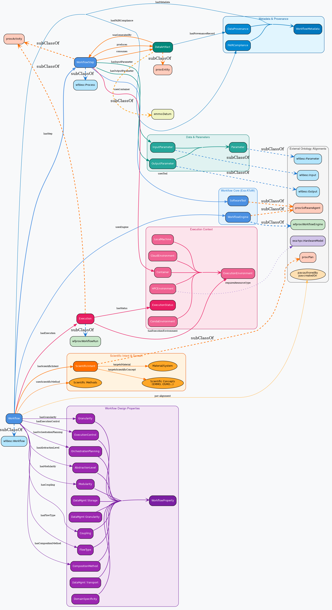
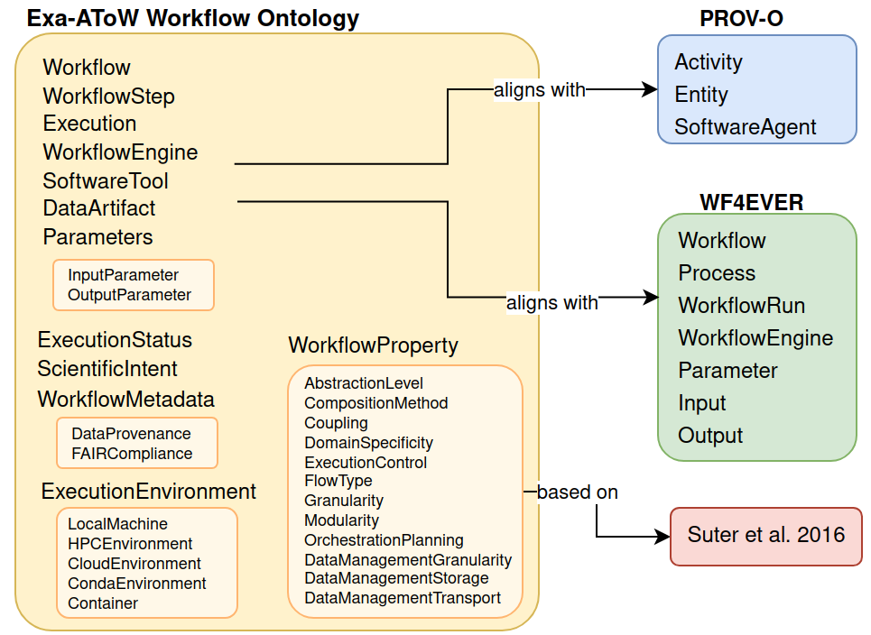

# Exa-AToW Ontologies

The **[Exa-AToW](https://numpex.org/exaatow-architectures-and-tools-for-large-scale-workflows/)** (Architectures and Tools for Large-Scale Workflows) project, part of the [NumPEx](https://numpex.org/) PEPR, aims at providing solutions for the efficient management of large-scale workflows composed of HPDA, AI, and HPC tasks distributed over a continuum of resources ranging from Exascale and HPC infrastructures to data infrastructures. 

This repository contains the formal ontologies developed for the project. They provide a structured, semantic representation of the concepts, relationships, and constraints needed to describe:

- **workflows** and their execution,
- **HPC resources and infrastructures**,
- **environmental impacts** of HPC jobs and resources,
- and the **application services** that publish and execute jobs.


## Quick links

| Resource | Link |
|---|---|
| Integrated ontology documentation | [index.html](index.html) |
| Integrated ontology source | [`exaatow_ontology.ttl`](exaatow_ontology.ttl) |
| Workflow ontology | [`workflow_ontology/`](workflow_ontology/) · [README](workflow_ontology/readme.md) · [documentation](https://cnherrera.github.io/Exa-AToW_onto/workflow_ontology/index-en.html) |
| HPC Resource ontology | [`hpc_ontology/`](hpc_ontology/) · [README](hpc_ontology/README.md) · [documentation](https://cnherrera.github.io/Exa-AToW_onto/hpc_ontology/index.html) |
| PIE / Impacts-HPC ontology | [`impactsHPC_ontology/`](impactsHPC_ontology/) · [README](impactsHPC_ontology/README.md) |
| Application Services ontology | [`application-services/`](application-services/) · [README](https://gitlab.com/ontologies_exa_atow/application-services/README.md) |
| Multi-ontology viewer | [`tools/onto_visualization/`](tools/onto_visualization/) |
| Partner construction guide | [Ontology Construction Guide for Exa-AToW Partners](#ontology-construction-guide-for-exa-atow-partners) |


## 🔍 Structure

Our project encompasses several complex domains - key concepts for the Exa-AToW ecosystem, and we've designed a modular set of ontologies to capture the specific knowledge in each area. Each ontology is described in specific folders:


1. [HPC Resource Ontology](https://github.com/logistica-dev/exa-atow-ontologies/tree/main/hpc_ontology) (High-Performance Computing) Environment Ontology: Covers physical and virtual resources in HPC, including compute nodes, storage, interconnects, and infrastructure.

2. Job Submission Ontology: This component focuses on the semantics of submitting computational jobs to various execution environments. It covers concepts like job parameters, resource requirements (e.g., CPU, memory, time), submission protocols, and execution targets.

3. [Processor Indicator Estimator Ontology](https://github.com/logistica-dev/exa-atow-ontologies/tree/main/impactsHPC_ontologyhttps://github.com/logistica-dev/exa-atow-ontologies/tree/main/impactsHPC_ontology): Groups estimation tools, metrics, and models used to assess processor indicators such as power consumption, thermal footprint, and die size.

4. [Workflow Ontology](https://github.com/logistica-dev/exa-atow-ontologies/tree/main/workflow_ontology): This ontology formally defines the concepts and relationships related to scientific and computational workflows. It models the structure, dependencies, execution logic, and state transitions of complex multi-step processes. Workflow Properties are  based on:  
  > Suter, F., et al. (2026). *A terminology for scientific workflow systems*. FGCS 174, 107974. [DOI](https://doi.org/10.1016/j.future.2025.107974)

5. Open Research Knowledge Infrastructure Ontology: It provides a unified semantic framework for representing the core entities, relationships, and processes that make up the modern research ecosystem. Its goal is to integrate and harmonize persistent identifier (PID) systems—such as ORCID (people), ROR (organizations), DOI (publications), SWHID (software), and RAiD (projects)—with structured descriptions of research infrastructures, workflows, data flows, and digital services. By doing so, ORKI-O enables interoperable knowledge graphs that connect researchers, institutions, scholarly outputs, software, computational environments, and data-producing activities in a coherent, machine-actionable way.


## Ontology Construction: For Exa-AToW partners!

### Steps are described in:
https://github.com/logistica-dev/exa-atow-ontologies/blob/main/Steps_generate_ontology.md


---

## 1. Ontology landscape

The repository is organised as a set of domain ontologies plus one integration layer.

| Layer | Location | Main files | Namespace | Purpose |
|---|---|---|---|---|
| **Integrated ontology** | repository root | `exaatow_ontology.ttl` | imports domain namespaces | Imports the three core domain ontologies and adds cross-domain alignments |
| **Workflow Ontology** | `workflow_ontology/` | `exaatow_workflow_ontology.ttl`, `separate_data/exato-wf.ttl`, `development-dp/` | `https://w3id.org/Exa-AToW/exato-wf.ttl#` | Describes workflows, steps, parameters, data, engines, execution, provenance, and workflow properties |
| **HPC Resource Ontology** | `hpc_ontology/` | `hpc-core.ttl`, `hpc.ttl` | `https://w3id.org/Exa-AToW/hpc#` | Describes HPC centres, supercomputers, partitions, nodes, hardware, software, storage, and infrastructure |
| **PIE / Impacts-HPC Ontology** | `impactsHPC_ontology/` | `PIE.ttl`, `PIE.rdf` | upstream Impacts-HPC namespace | Describes environmental impact assessment for jobs, servers, clusters, and components |
| **Application Services Ontology** | `application-services/` | `AaaS ontology.ttl` | local/application-services namespace | Emerging ontology for HAPS, runtimes, runners, and jobs |

### What each ontology answers

- **Workflow Ontology** — *What is the workflow, what are its steps and dependencies, how is it executed, and where does its data come from?*
- **HPC Resource Ontology** — *Where does it run, on which centre, system, partition, node, accelerator, storage, or software stack?*
- **PIE / Impacts-HPC Ontology** — *What is the environmental impact of the job, server, cluster, or component, and how was that impact estimated?*
- **Integration layer** — *How do these three views connect into one knowledge graph?*

---

## 2. Workflow Ontology

The **Exa-AToW Workflow Ontology** provides a semantic framework for describing scientific and computational workflows, their execution environments, provenance, workflow properties, and interoperability across heterogeneous Workflow Management Systems (WMS).

It is designed to support reproducibility, interoperability, FAIR workflows, and the semantic characterisation of complex computational pipelines.

### 2.1 Standards and alignments

The ontology extends and aligns with:

- **W3C PROV-O** for provenance representation,
- **WF4EVER** (`wfdesc` and `wfprov`) for workflow description and execution provenance,
- **PAV** for versioning and attribution,
- a workflow-property framework inspired by **Suter et al. (2026)** for describing workflow design and execution characteristics.

| Standard | Purpose |
|---|---|
| **PROV-O** | Provenance modelling: plans, activities, agents, usage, generation |
| **WF4EVER `wfdesc`** | Workflow structure description |
| **WF4EVER `wfprov`** | Workflow execution provenance |
| **PAV** | Versioning and attribution |
| **Suter et al. framework** | Workflow property characterisation |

### 2.2 Main modelling choices

- A **`Workflow`** is modelled as a `prov:Plan`.
- A **`WorkflowExecution` / `Execution`** is modelled as a `prov:Activity`.
- **`WorkflowStep`** represents a task, command, or function inside a workflow.
- Steps can be connected through dependencies and data links.
- **Input and output parameters** are modelled explicitly.
- **Data artefacts** and data provenance are represented in the workflow/data modules.
- **Execution environments** include local machines, HPC environments, cloud environments, containers, and Conda environments.
- **Workflow properties** describe granularity, modularity, flow type, coupling, data-management strategy, orchestration, execution control, and related characteristics.

Key classes include:

`Workflow`, `WorkflowStep`, `Execution`, `ExecutionEnvironment`, `HPCEnvironment`, `CloudEnvironment`, `LocalMachine`, `WorkflowEngine`, `InputParameter`, `OutputParameter`, `DataArtifact`, `WorkflowProperty`, `WorkflowMetadata`, `ScientificIntent`.

Key relationships include:

`hasStep`, `dependsOn`, `connectsTo`, `hasInputParameter`, `hasOutputParameter`, `hasExecution`, `isExecutionOf`, `usesEngine`, `hasExecutionEnvironment`, `executedOnResource`, `hasProperty`, `hasProvenanceRecord`.

### 2.3 Workflow properties

The ontology captures workflow design and execution characteristics such as:

- granularity,
- modularity,
- flow type,
- coupling,
- data-management granularity, storage, and transport,
- orchestration and planning,
- execution control,
- abstraction level,
- domain specificity,
- FAIR compliance.

This component is based on:

> Suter, F., et al. (2026). *A terminology for scientific workflow systems*. Future Generation Computer Systems 174, 107974. [DOI](https://doi.org/10.1016/j.future.2025.107974)

### 2.4 CWL extension and development tooling

The workflow folder contains both the published ontology bundle and an active development track.

- The **CWL extension** models CWL workflows, command-line tools, expression tools, parameters, input/output bindings, type declarations, requirements, files, and directories.
- The **`development-dp/`** folder contains a self-contained development package with:
  - a revised core ontology (`v0.4.0`),
  - a revised CWL extension (`v0.4.0`),
  - SHACL shapes,
  - a Python pipeline to parse CWL, instantiate RDF, validate, reason, store, and query workflows,
  - an OTTR pattern file and an RML mapping example,
  - tests and a kinetic-energy end-to-end example.

### 2.5 Workflow files

| File / folder | Description |
|---|---|
| `workflow_ontology/exaatow_workflow_ontology.ttl` | Published workflow ontology bundle (`v0.1`) |
| `workflow_ontology/exaatow_workflow_ontology_full.ttl` | Workflow bundle with declared imports |
| `workflow_ontology/separate_data/exato-wf.ttl` | Modular workflow core (`v0.2`) importing the data module |
| `workflow_ontology/separate_data/exato-data.ttl` | Data and provenance module |
| `workflow_ontology/exato-wf-cwl-extension.ttl` | CWL extension (`v0.1`) |
| `workflow_ontology/development-dp/` | Active development package: `v0.4.0`, CWL, SHACL, CLI, tests, examples |
| `workflow_ontology/ontology.ttl`, `.owl`, `.jsonld`, `.nt` | Serialisations of the workflow ontology |
| `workflow_ontology/examples/kinetic_energy/` | End-to-end CWL-to-RDF example |
| `workflow_ontology/tools/` | CWL-to-TTL conversion helpers |
| `workflow_ontology/index-en.html` | Widoco documentation |
| `workflow_ontology/readme.md` | Detailed workflow ontology README |

### 2.6 Workflow status

The repository currently contains **two workflow tracks**:

1. the published bundle (`v0.1`), used by the integrated ontology, and
2. the development package (`development-dp/`, `v0.4.0`), which is the most complete reference for ongoing work.

Do not mix files from different tracks without checking with the workflow ontology maintainers. When extending the workflow ontology, state clearly which track you are targeting.

### 2.7 Workflow diagrams





---

## 3. HPC Resource Ontology

The **HPC Resource Ontology** is an OWL 2 DL knowledge representation for describing the hardware, software, storage infrastructure, and organisational structure of High-Performance Computing centres. It was developed within Exa-AToW as the semantic backbone for describing and comparing the French national supercomputing ecosystem.

Once instantiated with real system data, it supports structured SPARQL queries such as:

- Which partitions provide access to NVIDIA H100 or AMD MI250X GPUs?
- Which systems use Slurm? Which compilers are available per partition?
- What storage mounts are available to compute jobs?
- How does Adastra's AMD ROCm stack differ from Jean Zay's CUDA-based environment?

### 3.1 Namespace

```turtle
@prefix exa: <https://w3id.org/Exa-AToW/hpc#> .
```

### 3.2 Module structure

The ontology is published as **two modules sharing one namespace**:

| Module | IRI | Version | Scope |
|---|---|---|---|
| `hpc-core.ttl` | `https://w3id.org/Exa-AToW/hpc/hpc-core.ttl` | `0.3.0` | Minimal vocabulary: supercomputer, partitions, racks, compute nodes, hardware models and installed components, storage, software, organisations |
| `hpc.ttl` | `https://w3id.org/Exa-AToW/hpc/hpc.ttl` | `0.3.0` | Imports the core and adds infrastructure (cooling, PDU, energy management), interconnects, management controllers, software stack, file systems, storage mounts, archive systems, QoS, and performance metrics |

`hpc.ttl` imports `hpc-core.ttl`; consumers that only need the minimal vocabulary can import the core alone.

### 3.3 Architecture

The ontology is organised around disjoint top-level branches:

| Branch | Definition | Key classes |
|---|---|---|
| **HPC Center** | Institutional entity that operates and hosts one or more supercomputers | `HPCCenter` |
| **Organization** | Institutions operating or funding centres | `Organization`, `FundingAgency` |
| **Quantitative Value** | Typed numeric values with an associated unit | `DieSize`, `MemoryCapacity`, `TDP`, `Lifetime`, `Bandwidth`, `Frequency` |
| **HPC Resource** | All resources involved in high-performance computing | `Infrastructure`, `LogicalResource`, `PhysicalResource` |

Sub-branches of `HPCResource` include:

- **PhysicalResource** — tangible hardware: `Supercomputer`, `ComputeNode`, `HardwareModel`, `HardwareComponent`, and related classes.
- **LogicalResource** — scheduler-visible or software-defined resources: `Partition`, `QoS`, `FileSystem`, `StorageMount`, `Software`.
- **Infrastructure** — facility-level systems: `CoolingSystem`, `EnergyManagement`, `PowerDistributionUnit`.
- **Software** — compilers, operating systems, resource managers, monitoring, and logging.

### 3.4 HardwareModel vs HardwareComponent

A central design decision separates **abstract hardware specifications** (`HardwareModel`) from **contextualised instantiations** (`HardwareComponent`):

- **HardwareModel** — the component model or type, e.g. NVIDIA H100 or Intel Xeon Platinum; a conceptual class describing general specifications.
- **HardwareComponent** — the actual physical instance of a model installed in a specific system.

This supports statements such as “a node has *N* instances of the same component model”, provenance chains, targeted queries, and scalable management of configuration variants.

```text
ComputeNode
  ├─ hasCPUComponent ────────────► CPUComponent        ── refersToModel ──► CPU   (e.g. AMD EPYC 9654)
  ├─ hasAcceleratorCardComponent ► AcceleratorCardComp ── refersToModel ──► AcceleratorCard (e.g. MI250X)
  ├─ hasMemoryComponent ─────────► MemoryComponent     ── refersToModel ──► Memory / HBMMemory
  ├─ hasInterconnectComponent ───► InterconnectComp    ── refersToModel ──► Interconnect (e.g. Slingshot)
  └─ hasStorageComponent ────────► StorageComponent    ── refersToModel ──► SSD / HDD
```

### 3.5 Energy and impact input path

The ontology was designed to feed energy microservices and impact estimation:

```text
Partition
  └─ usesNodeType ──► ComputeNode
                         ├─ hasNominalPower ──► NominalPower
                         ├─ hasCPUComponent
                         │    └─ refersToModel ──► CPU ──► hasTDP ──► TDP
                         └─ hasAcceleratorCardComponent
                              └─ refersToModel ──► AcceleratorCard ──► hasTDP ──► TDP
```

- `NominalPower` on `ComputeNode` captures the full node power budget, including DRAM and board overhead.
- `TDP` on `Processor` and `AcceleratorCard` captures the manufacturer-specified per-component thermal design power.

### 3.6 Instances (ABox)

All HPC instance files share the namespace `https://w3id.org/Exa-AToW/hpc/instances#` and load together as one graph.

| File | Contents |
|---|---|
| `hpc_ontology/instances/hpc-centers.ttl` | Directory of French national HPC centres and their organisations/funders |
| `hpc_ontology/instances/hpc-instances-cines.ttl` | Full ABox for **CINES / Adastra** |
| `hpc_ontology/instances/hpc-instances-idris.ttl` | Full ABox for **IDRIS / Jean Zay** |
| `hpc_ontology/instances/hpc-instances-tgcc.ttl` | Full ABox for **TGCC / Irène + Topaze** |

Because the instance namespace is shared, the same real-world entity is referenced by the same IRI across files, so loading several ABoxes yields a single, de-duplicated knowledge graph.

### 3.7 Validation, querying, and visualisation

- **SHACL validation** — `hpc_ontology/shapes/` contains shapes and a validator for HPC centre instances and everything a centre aggregates (supercomputers, partitions, nodes, components, file systems, mounts, QoS, software).
- **SPARQL / triple store** — `hpc_ontology/jena/` provides a beginner-friendly Apache Jena + Fuseki setup, TDB2 database, example queries, and a natural-language chatbot.
- **Graphs** — `hpc_ontology/graphs/` contains DOT sources and generated SVG diagrams.
- **Documentation** — `hpc_ontology/index.html` is the Widoco documentation.
- **Knowledge-graph viewer** — `tools/onto_visualization/` loads several ontologies and ABoxes at the same time, with TBox and ABox toggles and shared-instance detection.

### 3.8 HPC files

| File / folder | Description |
|---|---|
| `hpc_ontology/hpc-core.ttl` | Core HPC TBox (`v0.3.0`) |
| `hpc_ontology/hpc.ttl` | Full HPC TBox (`v0.3.0`, imports the core) |
| `hpc_ontology/instances/` | Centre and system instance data |
| `hpc_ontology/shapes/` | SHACL shapes, validator, and valid/invalid examples |
| `hpc_ontology/jena/` | Fuseki, TDB2, SPARQL queries, Python client, chatbot |
| `hpc_ontology/graphs/` | DOT sources and SVG diagrams |
| `hpc_ontology/query/` | Additional query material |
| `hpc_ontology/index.html` | Widoco documentation |
| `hpc_ontology/README.md` | Detailed HPC ontology README |
| `hpc_ontology/test-dp/`, `test-tbox-abox/`, `check-french-instances/` | Review and validation sandboxes; not canonical ontology modules |

> **Note:** Older combined serialisations such as `exaatow_hpc_ontology.ttl`, `exaatow_hpc-core_ontology.ttl`, and `exaatow_hpc-full_ontology.ttl` also exist in the folder. Prefer the maintained `hpc-core.ttl` + `hpc.ttl` pair unless a consumer explicitly needs a combined file.

---

## 4. PIE / Impacts-HPC Ontology

The **PIE / Impacts-HPC Ontology** defines the conceptual framework underlying the [Impacts-HPC](https://gitlab.in2p3.fr/impacts-hpc/impacts-hpc) library. It covers the physical elements of HPC centres and the ecological aspects associated with their operation. Its goal is to promote data reuse and interoperability within and beyond Exa-AToW.

### 4.1 Key concepts

The ontology models:

- **HPC physical entities**: `park` (server park / data centre), `cluster`, `server`, `processor`, `cpu`, `gpu`, `ram`, `ssd`, `hdd`, `memoryStick`, `motherboard`, `powerSupply`, `chassis`, `battery`, `cooling`.
- **Impact assessment**: `impactAssessedObject`, `impactEstimation`, `embodiedImpact`, `usageImpact`, `embeddedImpact`, `environmentalImpactCategory`, `allocationMethod`.
- **Impact categories**: `adpe` (abiotic resource depletion), `gwp` (global warming potential), and `pec` (primary energy consumption).
- **Jobs**: `job` as an impact-assessed object executed on a cluster or server park.

### 4.2 Key relationships and attributes

Object properties include:

`executes` / `isExecutedOn`, `hasEstimatedImpact` / `isImpactEstimationOf`, `hasCategory` / `isCategoryOf`, `hasAllocationMethod` / `isAllocationMethodChosenFor`, `isComputedUsingMethod` / `isMethodUsedToCompute`, `isPartOfImpactComputationOf`.

Data properties include:

`coresNumber`, `dieSize`, `duration`, `gpuRamCapacity`, `memoryCapacity`, `nodesCount`, `thermalDesignPower`, `powerUsageEffectiveness`, `instantEnergyConsumption`, `idleEnergyConsumption`, `peakEnergyConsumption`, `serverConsumption`, `manufacturer`, `modelName`, `modelRange`, `processorFamily`, `workload`, and various battery, cooling, and impact factors.

### 4.3 PIE files

| File | Description |
|---|---|
| `impactsHPC_ontology/PIE.ttl` | PIE ontology in Turtle |
| `impactsHPC_ontology/PIE.rdf` | PIE ontology in RDF/XML |
| `impactsHPC_ontology/ontology_graph.jpg` | Ontology graph |
| `impactsHPC_ontology/README.md` | Detailed PIE / Impacts-HPC README |

Useful upstream links:

- [Ontology visualisation](https://ontology-impactshpc-8b7398.pages.in2p3.fr/ontology_visualisation/index-en.html)
- [Impacts-HPC on GitLab](https://gitlab.in2p3.fr/impacts-hpc/impacts-hpc)
- [Impacts-HPC on PyPI](https://pypi.org/project/impacts-hpc/)

> **Location note:** the canonical PIE files live in `impactsHPC_ontology/`. The `pie_ontology/` folder is currently a placeholder and does not contain an ontology.

---

## 5. How the three ontologies fit together

The root file [`exaatow_ontology.ttl`](exaatow_ontology.ttl) is the **integration and alignment layer**. It imports the three domain ontologies and adds cross-domain mappings.

### 5.1 Main cross-domain mappings

| From | Mapping | To |
|---|---|---|
| `hpc:Processor` | `owl:equivalentClass` | `pie:processor` |
| `hpc:CPU` | `owl:equivalentClass` | `pie:cpu` |
| `hpc:GPU` | `owl:equivalentClass` | `pie:gpu` |
| `hpc:RAM` | `owl:equivalentClass` | `pie:ram` |
| `hpc:SSD` | `owl:equivalentClass` | `pie:ssd` |
| `hpc:HDD` | `owl:equivalentClass` | `pie:hdd` |
| `hpc:Server` | `owl:equivalentClass` | `pie:server` |
| `hpc:Supercomputer` | `rdfs:subClassOf` | `pie:park` |
| `hpc:Partition` | `rdfs:subClassOf` | `pie:cluster` |
| `hpc:HPCResource` | `rdfs:subClassOf` | `pie:impactAssessedObject` |
| `hpc:coresCount` | `owl:equivalentProperty` | `pie:coresNumber` |

> Some mappings in the integration file still use older IRIs than the current domain modules. Treat the integration file as an alignment draft and confirm the exact IRIs before reusing a mapping in another ontology or query.

### 5.2 Workflow ↔ HPC ↔ PIE links

The integration layer also defines links such as:

- `exa:utilizesHPCResource` — from a workflow `ExecutionEnvironment` to an `hpc:HPCResource`.
- `exa:executedOnPartition` — from a workflow `Execution` to an `hpc:Partition`.
- `exa:usesComputeNode` — from a workflow `WorkflowStep` to an `hpc:ComputeNode`.
- `exa:hasEnvironmentalImpact` — from a workflow entity to a `pie:impactEstimation`.
- `exa:WorkflowExecutionContext` — a class that combines a workflow execution, the HPC infrastructure used, and the associated environmental impact.

The integrated ontology is maintained centrally. Domain modules should not redefine these integration terms; proposed cross-domain mappings should be discussed with the ontology coordinators.

> **Status:** the integration file also contains some provisional alignments that are still under discussion. Treat cross-domain mappings as reviewable design decisions, not as immutable facts.

---

## 6. Repository structure

```text
Exa-AToW_onto/
├── exaatow_ontology.ttl                 # Integrated ontology: imports + cross-domain alignments
├── index-en.html                        # Widoco documentation for the integrated ontology
├── README.md                            # Current README
├── README_updated.md                    # This proposed updated README
├── Steps_generate_ontology.md           # Historical partner guide (concepts still useful; JSON examples obsolete)
│
├── workflow_ontology/
│   ├── exaatow_workflow_ontology.ttl    # Published workflow bundle (v0.1)
│   ├── exaatow_workflow_ontology_full.ttl
│   ├── exato-wf-cwl-extension.ttl       # CWL extension (v0.1)
│   ├── separate_data/
│   │   ├── exato-wf.ttl                 # Modular workflow core (v0.2)
│   │   └── exato-data.ttl               # Data/provenance module
│   ├── development-dp/                  # Active development: v0.4.0, CWL, SHACL, CLI, tests
│   ├── ontology.ttl / .owl / .jsonld / .nt
│   ├── examples/kinetic_energy/         # End-to-end CWL → RDF example
│   ├── tools/                           # CWL-to-TTL helpers
│   ├── use_cases/                       # Use-case material
│   ├── index-en.html                    # Workflow documentation
│   ├── readme.md                        # Workflow README
│   └── resources/, webvowl/
│
├── hpc_ontology/
│   ├── hpc-core.ttl                     # Core HPC TBox (v0.3.0)
│   ├── hpc.ttl                          # Full HPC TBox (v0.3.0, imports core)
│   ├── instances/                       # ABox: centres, CINES, IDRIS, TGCC
│   ├── shapes/                          # SHACL shapes + validator + examples
│   ├── jena/                            # Fuseki/TDB2, SPARQL queries, Python client, chatbot
│   ├── graphs/                          # DOT sources and SVG diagrams
│   ├── query/, resources/, images/, webvowl/
│   ├── index.html                       # HPC documentation
│   ├── README.md                        # HPC README
│   └── test-dp/, test-tbox-abox/, check-french-instances/   # Review sandboxes
│
├── impactsHPC_ontology/                 # PIE ontology
│   ├── PIE.ttl
│   ├── PIE.rdf
│   ├── ontology_graph.jpg
│   └── README.md
├── pie_ontology/                        # Placeholder only (no ontology files yet)
│
├── application-services/                # Application Services / AaaS ontology (emerging)
│   ├── AaaS ontology.ttl
│   ├── Application_Services.svg
│   ├── README.md
│   └── test-dp/                         # Review sandbox
│
├── HPC-Centers/                         # Early French HPC centre/software instance data
├── tools/
│   └── onto_visualization/              # Multi-ontology TBox/ABox viewer
├── resources/                           # Shared documentation assets
├── webvowl/                             # Bundled WebVOWL assets
│
└── legacy, do not extend:
    ├── files/                           # Old JSON definitions
    ├── ontology_generator.py            # Old JSON → Turtle generator
    └── help_to_generate_onto_fromIA.html
```

### Notes on the structure

- **Published ontology modules** are the `.ttl` files in `workflow_ontology/`, `hpc_ontology/`, `impactsHPC_ontology/`, and the root integration file.
- **`development-dp/`, `test-dp/`, `test-tbox-abox/`, `check-french-instances/`, and `application-services/test-dp/`** are development or review sandboxes. They are useful for testing, but they are not authoritative ontology files unless explicitly promoted.
- **`pie_ontology/`** is currently an empty placeholder. Use `impactsHPC_ontology/` for PIE.
- **`files/` and `ontology_generator.py` are legacy.** The JSON-based generation workflow is retired. Do not add new JSON definitions or run the old generator for new ontology work.
- **`Steps_generate_ontology.md`** remains useful for its conceptual explanations of classes, object properties, data properties, instances, and restrictions. Its JSON mechanics no longer apply; use the OWL/Turtle guide in the next section instead.
- Generated documentation (`index-en.html`, `index.html`, WebVOWL data) should be regenerated through the agreed tooling rather than edited by hand.

---

## 7. Ontology Construction Guide for Exa-AToW Partners

### 7.1 Important change: no more JSON

The previous workflow used JSON files in `files/` plus `ontology_generator.py` to generate Turtle. **That workflow is retired.**

New ontology content must be written **directly as OWL/Turtle** (or edited in Protégé and saved as Turtle). Partners should:

- add classes, object properties, data properties, restrictions, and instances directly in the relevant `.ttl` module,
- use an OWL editor or a text editor with Turtle support,
- validate with an OWL reasoner and, where available, SHACL,
- submit changes through a branch and pull request.

Do **not** create new `sub_*_classes.json`, `properties_*.json`, `instances_*.json`, or `add_restrictions_*.json` files.

### 7.2 What you need

| Tool | Why |
|---|---|
| **Protégé 5.6+** (recommended) | Graphical OWL editor; add classes/properties, edit annotations, run HermiT/ELK, save as Turtle |
| **A text editor** | Direct Turtle editing and review |
| **`rdflib`** | Parse and inspect Turtle files from Python |
| **`pyshacl`** | Validate instances against SHACL shapes |
| **Apache Jena / Fuseki** | Load the ontology into a triple store and run SPARQL queries |
| **WebVOWL / the repository viewer** | Visualise classes, properties, and instances |
| **Git** | Branch, review, and pull request |

Protégé is the easiest route if you are not comfortable writing Turtle by hand. Create or open the relevant `.ttl` file, add your entities through the interface, run the reasoner, and save the file in **Turtle** format.

### 7.3 The building blocks

| Concept | Meaning | Example |
|---|---|---|
| **Class** | A type of thing or concept | `ComputeNode`, `WorkflowStep`, `Server` |
| **Object property** | A relationship between two classes | `hasProcessor`: `ComputeNode` → `Processor` |
| **Data property** | A relationship between a class and a literal value | `hasCoreCount`: `Processor` → `xsd:integer` |
| **Individual / instance** | A named, concrete example of a class | `Adastra` is an instance of `Supercomputer` |
| **Restriction** | A constraint on how a property may be used | a `DieSize` must have exactly one value and one unit |
| **TBox** | The vocabulary and rules: classes, properties, restrictions | `hpc-core.ttl`, `hpc.ttl` |
| **ABox** | The facts: named instances and their relationships | `hpc_ontology/instances/*.ttl` |

### 7.4 Before you start

1. **Choose the right module.** Workflow content goes in `workflow_ontology/`; HPC content in `hpc_ontology/`; impact content in `impactsHPC_ontology/`; application-service content in `application-services/`.
2. **Use the existing namespace.** Do not mint a new namespace unless you are creating a genuinely new ontology module. Ask the coordinators first.
3. **Search for existing terms.** Reuse an existing class or property instead of creating a near-duplicate.
4. **Check whether the concept is TBox or ABox.** Classes and properties go in the ontology module; concrete named examples go in an instance file.
5. **Plan bilingual annotations.** English labels and comments are required for tooling; French labels and comments are strongly encouraged.
6. **Work on a branch.** Do not edit the integration file or generated documentation unless the coordinators ask you to.

### 7.5 Adding a class

A class represents a concept in your domain. Use `rdfs:subClassOf` to place it in the existing hierarchy.

```turtle
@prefix exa:  <https://w3id.org/Exa-AToW/hpc#> .
@prefix owl:  <http://www.w3.org/2002/07/owl#> .
@prefix rdfs: <http://www.w3.org/2000/01/rdf-schema#> .
@prefix skos: <http://www.w3.org/2004/02/skos/core#> .

exa:NewConcept a owl:Class ;
    rdfs:subClassOf exa:HPCResource ;
    rdfs:label "New concept"@en , "Nouveau concept"@fr ;
    skos:prefLabel "New concept"@en , "Nouveau concept"@fr ;
    rdfs:comment "A clear definition of the concept."@en ,
                 "Une définition claire du concept."@fr ;
    rdfs:isDefinedBy <https://w3id.org/Exa-AToW/hpc/hpc-core.ttl> .
```

Guidelines:

- Use **UpperCamelCase** for class names.
- Give every class at least an English `rdfs:label` and `rdfs:comment`.
- Add a French label/comment whenever possible.
- Use `rdfs:isDefinedBy` to point to the module that defines the term.
- Do not create a class if an existing class already covers the concept.
- Multiple inheritance is allowed in OWL: a class may have several `rdfs:subClassOf` statements. Use it deliberately and document why.

### 7.6 Adding an object property

An object property links two classes.

```turtle
@prefix exa:  <https://w3id.org/Exa-AToW/hpc#> .
@prefix owl:  <http://www.w3.org/2002/07/owl#> .
@prefix rdfs: <http://www.w3.org/2000/01/rdf-schema#> .

exa:hasNewComponent a owl:ObjectProperty ;
    rdfs:domain exa:ComputeNode ;
    rdfs:range  exa:HardwareComponent ;
    rdfs:label "has new component"@en , "a un nouveau composant"@fr ;
    rdfs:comment "Links a compute node to one of its new components."@en ,
                 "Relie un nœud de calcul à l'un de ses nouveaux composants."@fr ;
    rdfs:isDefinedBy <https://w3id.org/Exa-AToW/hpc/hpc.ttl> .
```

If the relationship has a natural inverse, declare it:

```turtle
@prefix exa:  <https://w3id.org/Exa-AToW/hpc#> .
@prefix owl:  <http://www.w3.org/2002/07/owl#> .
@prefix rdfs: <http://www.w3.org/2000/01/rdf-schema#> .

exa:isNewComponentOf a owl:ObjectProperty ;
    owl:inverseOf exa:hasNewComponent ;
    rdfs:label "is new component of"@en , "est un nouveau composant de"@fr .
```

Guidelines:

- Use **lowerCamelCase** and a verb-style name.
- Declare `rdfs:domain` and `rdfs:range` whenever they are known.
- Use `rdfs:subPropertyOf` when your property specialises an existing property.
- Remember that `rdfs:domain` and `rdfs:range` are **inference rules**, not hard validation rules. Use SHACL when you need a violation to be reported.
- Prefer reusing an existing property over creating a synonym.

### 7.7 Adding a data property

A data property links a class to a literal value.

```turtle
@prefix exa:  <https://w3id.org/Exa-AToW/hpc#> .
@prefix owl:  <http://www.w3.org/2002/07/owl#> .
@prefix rdfs: <http://www.w3.org/2000/01/rdf-schema#> .
@prefix xsd:  <http://www.w3.org/2001/XMLSchema#> .

exa:hasNewCount a owl:DatatypeProperty ;
    rdfs:domain exa:NewConcept ;
    rdfs:range  xsd:nonNegativeInteger ;
    rdfs:label "has new count"@en , "a un nouveau nombre"@fr ;
    rdfs:comment "The number of items of this kind."@en ,
                 "Le nombre d'éléments de ce type."@fr ;
    rdfs:isDefinedBy <https://w3id.org/Exa-AToW/hpc/hpc.ttl> .
```

Recommended XSD ranges:

| Need | Range |
|---|---|
| Text | `xsd:string` |
| Integer count | `xsd:integer` or `xsd:nonNegativeInteger` |
| Measured number | `xsd:decimal` |
| Boolean flag | `xsd:boolean` |
| Date | `xsd:date` |
| Date and time | `xsd:dateTime` |
| Duration | `xsd:duration` |
| URL / identifier | `xsd:anyURI` |

Guidelines:

- Use **lowerCamelCase**.
- Use typed literals for numbers, dates, and booleans. Do not store a number as a string unless there is a documented reason.
- Use language-tagged strings for human-readable text (`"..."@en`, `"..."@fr`).
- Do not use a data property for something that should point to another class; use an object property instead.

### 7.8 Restrictions and measurements (`hasValue` / `hasUnit`)

Restrictions add constraints to classes. They are written as OWL restriction axioms, not as separate JSON files.

For measurements, follow the existing `QuantitativeValue` pattern: a measurement class has exactly one numeric value and exactly one unit.

```turtle
@prefix exa:  <https://w3id.org/Exa-AToW/hpc#> .
@prefix owl:  <http://www.w3.org/2002/07/owl#> .
@prefix rdfs: <http://www.w3.org/2000/01/rdf-schema#> .
@prefix xsd:  <http://www.w3.org/2001/XMLSchema#> .

exa:ExampleSize a owl:Class ;
    rdfs:subClassOf exa:QuantitativeValue ;
    rdfs:subClassOf [
        a owl:Restriction ;
        owl:onProperty exa:hasValue ;
        owl:cardinality "1"^^xsd:nonNegativeInteger
    ] ,
    [
        a owl:Restriction ;
        owl:onProperty exa:hasUnit ;
        owl:cardinality "1"^^xsd:nonNegativeInteger
    ] ;
    rdfs:label "Example size"@en , "Taille d'exemple"@fr ;
    rdfs:comment "A size measurement with exactly one value and one unit."@en ,
                 "Une mesure de taille avec exactement une valeur et une unité."@fr .
```

Then link a domain class to the measurement:

```turtle
@prefix exa:  <https://w3id.org/Exa-AToW/hpc#> .
@prefix owl:  <http://www.w3.org/2002/07/owl#> .
@prefix rdfs: <http://www.w3.org/2000/01/rdf-schema#> .

exa:hasExampleSize a owl:ObjectProperty ;
    rdfs:domain exa:Processor ;
    rdfs:range  exa:ExampleSize ;
    rdfs:label "has example size"@en , "a une taille d'exemple"@fr .
```

And, if you need an instance:

```turtle
@prefix exa:  <https://w3id.org/Exa-AToW/hpc#> .
@prefix inst: <https://w3id.org/Exa-AToW/hpc/instances#> .

inst:ExampleSize_450mm2 a exa:ExampleSize ;
    exa:hasValue 450.0 ;
    exa:hasUnit "mm²" .
```

Use this pattern whenever a measurement needs both a number and a unit, for example:

- die size (450 mm²),
- memory capacity (64 GB),
- power (250 W),
- duration (30 minutes),
- bandwidth (200 Gb/s).

The old `add_restrictions_*_hasValue_hasUnit.json` files are replaced by OWL restrictions such as the one above.

### 7.9 Adding instances

Instances are named individuals. They belong in an ABox file, not in the TBox module.

```turtle
@prefix exa:  <https://w3id.org/Exa-AToW/hpc#> .
@prefix inst: <https://w3id.org/Exa-AToW/hpc/instances#> .
@prefix rdfs: <http://www.w3.org/2000/01/rdf-schema#> .

inst:ExampleNode a exa:ComputeNode ;
    rdfs:label "Example node"@en , "Nœud exemple"@fr ;
    exa:coresCountPerNode 128 ;
    exa:belongsToPartition inst:ExamplePartition .
```

Guidelines:

- Use a shared instance namespace so the same real-world entity is de-duplicated across files.
- Create instances only for **stable, well-known, reusable** things, not for temporary or user-specific data.
- Keep instance files separate from the TBox.
- If your instances are generated from another source, keep the generation script with the data and document how to reproduce it.
- Validate instances against the available SHACL shapes before submitting.

### 7.10 Reusing and aligning with existing vocabularies

Before defining a new term:

1. Search the repository:
   ```bash
   grep -R "MyConcept" --include="*.ttl" .
   ```
2. Search the ontology in Protégé.
3. Check the external vocabularies already used by the project: PROV-O, WF4EVER, PAV, SKOS, schema.org, and `org:`.

Useful alignment patterns:

| Pattern | Use |
|---|---|
| `rdfs:subClassOf` | Your class is a narrower concept than an existing class |
| `rdfs:subPropertyOf` | Your property specialises an existing property |
| `owl:equivalentClass` | Two classes mean the same thing |
| `owl:equivalentProperty` | Two properties mean the same thing |
| `owl:inverseOf` | Two properties are inverses |
| `rdfs:seeAlso` | Related documentation or ontology |
| `skos:closeMatch` | Loose cross-vocabulary correspondence; use with care |

Do **not** use `owl:sameAs` casually. It asserts that two IRIs denote exactly the same individual and can have strong unintended consequences under reasoning.

### 7.11 Validate your contribution

At minimum:

1. **Parse the file.** A Turtle syntax error makes the whole module unusable.
   ```bash
   python3 -c "import rdflib; rdflib.Graph().parse('path/to/file.ttl', format='turtle'); print('OK')"
   ```
2. **Run a reasoner in Protégé** (HermiT or ELK). Check for:
   - unsatisfiable classes,
   - unexpected inferred subsumptions,
   - inconsistent individuals.
3. **Run SHACL** where shapes exist:
   ```bash
   cd hpc_ontology/shapes
   python3 validate.py --data ../instances/hpc-centers.ttl
   ```
4. **Run the workflow tests** if you change workflow code or shapes:
   ```bash
   cd workflow_ontology/development-dp
   ./run_tests.sh
   ```
5. **Run representative SPARQL queries** or competency questions to check that the new terms are usable.
6. **Check annotations:** English and French labels/comments, no typos in IRIs, no missing prefixes, no accidental duplicate entities.
7. **Check that you did not break imports** or redefine a term that belongs to another module.

### 7.12 Naming and metadata conventions

| Element | Convention | Example |
|---|---|---|
| Class | UpperCamelCase | `AcceleratorCard` |
| Object property | lowerCamelCase, verb phrase | `hasAcceleratorCardComponent` |
| Data property | lowerCamelCase | `coresCountPerNode` |
| Individual | UpperCamelCase or a stable domain identifier | `SC_Adastra` |
| Namespace | Existing module namespace | `https://w3id.org/Exa-AToW/hpc#` |
| Instance namespace | Shared ABox namespace | `https://w3id.org/Exa-AToW/hpc/instances#` |
| Label | `rdfs:label` + `skos:prefLabel`, EN/FR | `"Processor"@en`, `"Processeur"@fr` |
| Definition | `rdfs:comment`, EN/FR | bilingual definition |
| Provenance | `rdfs:isDefinedBy` | module IRI |
| Version | `owl:versionInfo`, `dcterms:modified` | module metadata |

### 7.13 Worked example: Processor and die size

The following compact example shows the complete pattern in Turtle. Adapt the namespace and parent classes to your module.

```turtle
@prefix exa:  <https://w3id.org/Exa-AToW/hpc#> .
@prefix inst: <https://w3id.org/Exa-AToW/hpc/instances#> .
@prefix owl:  <http://www.w3.org/2002/07/owl#> .
@prefix rdfs: <http://www.w3.org/2000/01/rdf-schema#> .
@prefix xsd:  <http://www.w3.org/2001/XMLSchema#> .

# A processor is an HPC resource
exa:Processor a owl:Class ;
    rdfs:subClassOf exa:HPCResource ;
    rdfs:label "Processor"@en , "Processeur"@fr .

# Die size is a quantitative value: one value + one unit
exa:DieSize a owl:Class ;
    rdfs:subClassOf exa:QuantitativeValue ;
    rdfs:subClassOf [
        a owl:Restriction ;
        owl:onProperty exa:hasValue ;
        owl:cardinality "1"^^xsd:nonNegativeInteger
    ] ,
    [
        a owl:Restriction ;
        owl:onProperty exa:hasUnit ;
        owl:cardinality "1"^^xsd:nonNegativeInteger
    ] ;
    rdfs:label "Die size"@en , "Taille de puce"@fr ;
    rdfs:comment "The physical area of a processor die."@en ,
                 "La surface physique d'une puce de processeur."@fr .

# Relationship from a processor to its die size
exa:hasDieSize a owl:ObjectProperty ;
    rdfs:domain exa:Processor ;
    rdfs:range  exa:DieSize ;
    rdfs:label "has die size"@en , "a une taille de puce"@fr ;
    rdfs:comment "Processor has a die size, including a value and a unit."@en ,
                 "Le processeur a une taille de puce, incluant une valeur et une unité."@fr .

# A concrete measurement instance
inst:DieSize_Example_450mm2 a exa:DieSize ;
    exa:hasValue 450.0 ;
    exa:hasUnit "mm²" .
```

### 7.14 Submitting your contribution

1. Create a branch with a descriptive name, for example `hpc/add-cooling-component`.
2. Make the smallest coherent change.
3. Include:
   - the updated `.ttl` file(s),
   - example instances if they help reviewers,
   - validation output (reasoner, SHACL, or tests),
   - a short explanation of **what** you added and **why**.
4. Update the relevant module README if the new content changes the documented scope.
5. Open a pull request against the main repository.
6. The ontology coordinators review consistency, naming, imports, and cross-domain impact before merging.

Do **not** edit the integrated ontology, generated HTML documentation, or another partner's module unless the coordinators explicitly ask you to.

### 7.15 Partner checklist

- [ ] I chose the correct ontology module and namespace.
- [ ] I searched for and reused existing classes/properties where possible.
- [ ] New classes have English and French labels/comments.
- [ ] New object properties declare domain/range and, where useful, an inverse.
- [ ] New data properties use appropriate XSD datatypes.
- [ ] Measurements use the `QuantitativeValue` / `hasValue` / `hasUnit` pattern.
- [ ] Instances are in an ABox file and use the shared instance namespace.
- [ ] I did not create or modify JSON definition files.
- [ ] I did not hand-edit generated documentation.
- [ ] The Turtle parses without errors.
- [ ] The reasoner reports no inconsistencies or unsatisfiable classes.
- [ ] SHACL/tests pass where applicable.
- [ ] I added example data or queries that show the new terms in use.
- [ ] I opened a pull request with a clear description and validation evidence.

### 7.16 Frequently asked questions

**Q: What is the difference between an object property and a data property?**
- An **object property** links two classes, for example `Job → ComputeNode`.
- A **data property** links a class to a literal value, for example `Job → duration in seconds`.

**Q: When do I need `hasValue` / `hasUnit`?**
- Whenever a measurement needs both a number and a unit: size (450 mm²), memory (64 GB), power (250 W), time (30 minutes).
- In the current workflow this is expressed as an OWL restriction pattern, not as a separate JSON file.

**Q: Should I create instances?**
- Only for stable, well-known, reusable things that everyone in the domain recognises (for example SLURM, MPI, or In-Memory storage).
- Do not create instances for user-specific, temporary, or generated data unless that is the purpose of your ABox.

**Q: How do I link my class to an existing one?**
- Use `rdfs:subClassOf` to say your class is a narrower concept.
- Use an object property with the appropriate domain and range to link individuals.
- Use `owl:equivalentClass` or `owl:equivalentProperty` only when the concepts are truly equivalent.

**Q: Can a class have multiple parent classes?**
- Yes. OWL supports multiple inheritance: a class may have several `rdfs:subClassOf` statements.
- This is a change from the old JSON structure, which supported only one `parent_class`.

**Q: Do I need to edit `exaatow_ontology.ttl`?**
- No. The integration file is maintained by the coordinators. Propose the cross-domain mapping in your pull request and they will integrate it.

**Q: Can I use Protégé instead of writing Turtle by hand?**
- Yes, and it is recommended. Open the relevant `.ttl` file, add your entities in Protégé, run the reasoner, and save as Turtle.

**Q: What about `Steps_generate_ontology.md`?**
- Its conceptual explanations of classes, object properties, data properties, instances, and restrictions are still useful.
- Its JSON examples and its `ontology_generator.py` mechanics are obsolete. Use the OWL/Turtle patterns in this section instead.

**Q: What if I need a new top-level class or a new ontology module?**
- Discuss it with the ontology coordinators first. A new top-level branch or module affects the whole knowledge graph and may need a new namespace, documentation, and integration mappings.

---

## 8. Validation, querying, and visualisation

### 8.1 SHACL

- HPC: `hpc_ontology/shapes/hpc-shapes.ttl` and `hpc_ontology/shapes/validate.py`.
- Workflow: `workflow_ontology/development-dp/ontology/exato-wf-shapes.ttl` and `exato-wf-cwl-shapes.ttl`.

Example:

```bash
cd hpc_ontology/shapes
python3 validate.py --data example-hpc-center.ttl
python3 validate.py --data ../instances/hpc-centers.ttl \
                              ../instances/hpc-instances-cines.ttl \
                              ../instances/hpc-instances-idris.ttl \
                              ../instances/hpc-instances-tgcc.ttl
```

### 8.2 SPARQL with Apache Jena / Fuseki

See the beginner-friendly guide in [`hpc_ontology/jena/README.md`](hpc_ontology/jena/README.md).

```bash
cd hpc_ontology/jena
make serve
```

Then open `http://localhost:3030` and query the `hpc` dataset, or use the Python client in `hpc_ontology/jena/python/`.

### 8.3 Visualisation

- The multi-ontology viewer is in [`tools/onto_visualization/`](tools/onto_visualization/).
- It can load the Workflow, HPC, and PIE TBoxes plus HPC and workflow ABoxes, and it detects shared instances across sources.
- WebVOWL bundles are available in `webvowl/`, `workflow_ontology/webvowl/`, and `hpc_ontology/webvowl/`.
- Widoco documentation is generated in `index-en.html` (integrated), `workflow_ontology/index-en.html`, and `hpc_ontology/index.html`.

---

## 9. Contributing

- Use the repository issue tracker for questions, bug reports, and ontology-change proposals.
- Discuss new top-level concepts, namespaces, or cross-domain mappings with the ontology coordinators before implementing them.
- Keep changes focused and reviewable.
- Include validation evidence in pull requests.
- Follow the partner construction guide above.

---

## 10. License

Licensing is specified in the individual ontology folders and in the upstream project. The Workflow Ontology README states **CC-BY 4.0**; check the relevant folder README and repository metadata for the other modules before redistributing.

---

## 11. Contact

For questions, issues, or contributions, use the repository issue tracker:

- [Exa-AToW ontology repository issues](https://github.com/logistica-dev/exa-atow-ontologies/issues)

For ontology-specific questions, see the contacts and links in:

- [`workflow_ontology/readme.md`](workflow_ontology/readme.md)
- [`hpc_ontology/README.md`](hpc_ontology/README.md)
- [`impactsHPC_ontology/README.md`](impactsHPC_ontology/README.md)
- [`application-services/README.md`](application-services/README.md)
